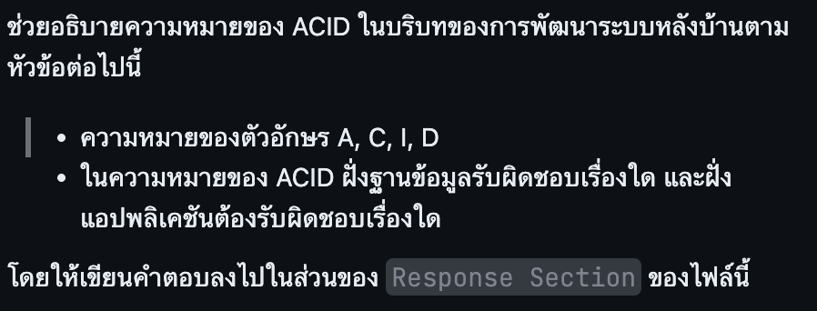

## Question

## Response Section
1. ความหมายของ ACID
- Atomicity
    - ใน transaction มีอยู่ 2 status ไม่สำเร็จก็ล้มเหลว ก็คือ ต้องทำสำเร็จและทำการ commit ลงในฐานข้อมูล และถ้ามีจุดไหน fail ให้ทำการ rollback กลับไปตั้งแต่ต้น
- Consistency
    - ในการทำ transaction ต้องมีการอัปเดตฐานข้อมูลจากสถานะที่ถูกต้องหนึ่งไปสู่อีกสถานะที่ถูกต้องเสมอ และทำตามกฎและข้อจำกัดที่ตั้งไว้ทั้งหมด
        - เช่น บัญชี A มีเงิน 200 บาท บัญชี B มี 300 บาท (รวม 500 บาท) ถ้าโอนเงินจาก A ไป B 100 บาท เงินคงเหลือของ A 100 บาท และ B 400 บาท (รวม 500 บาท) ภายใต้กฎแต่ละบัญชีมีเงิน >= 0
- Isolation
    - เมื่อมีหลาย transaction ทำงานพร้อมๆกัน แต่ละรายการต้องทำงานแยกกัน และจะไม่เห็นผลลัพธ์ระหว่างทางของแต่ละ transaction จนกว่าจะทำงานสำเร็จ 
        - เช่น ถ้า2คนโอนเงินเข้ามาใน 1บัญชี ผลลัพธ์ต้องได้ ยอดโอนเป็นผลรวมของยอดโอนของทั้ง2 transaction ไม่ใช่ได้ผลแค่ของ 1 ใน 2 transaction นั้น
- Durability
    - เมื่อ tranaction ทำเสร็จแล้วและทำการ commit เสร็จ ข้อมูลที่บันทึกจะบันทึกลงในหน่วยความจำถาวรเช่น SSD, HDD และ CLOUD เป็นต้น ทำให้เมื่อเกิดเหตุการณ์ไม่คาดฝัน หรืออุบัติเหตุต่างๆจะไม่ทำให้ข้อมูลหายและสามารถกู้คืนได้

2. ACID ฝั่งฐานข้อมูลรับผิดชอบเรื่องใด และฝั่งแอปพลิเคชั่นรับผิดชอบเรื่องใด

| ฐานข้อมูล 	| แอปพลิเคชั่น 	|
| -------   | ---------     |
| A : ระบบจัดการ log เพื่อควบคุมการ 'COMMIT' และ 'ROLLBACK' สำหรับข้อมูลที่จะย้อนกลับไปจุดเริ่มต้นเมื่อเกิดการ fail   | A : กำหนดขอบเขตของ transaction ให้ครอบคลุม
| C : จัดการ schema ตั้งเกี่ยวกับ primary key, foreign key, data types ต่างๆ    		   | C : ในระดับ business logic เขียน code ให้ถูกต้องตาม logic ที่ต้องการ
| I : ควบคุมการเข้าถึงข้อมูลพร้อมๆกัน ด้วยการ rows locking                           	   | I : เขียน code สำหรับ error handle เมื่อเกิด deadlock  
| D : ทำการบันทึกข้อมูลลงในฐานข้อมูลถาวรผ่าน log เพื่อป้องกันข้อมูลหายเมื่อเกิดเหตุไฟดับหรือระบบล่ม  | D : ตรวจสอบและรอรับการยืนยัน 'COMMIT' เสร็จจากฐานข้อมูล ก่อนดำเนินการขั้นต่อไป