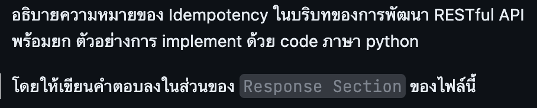

## Question

## Response Section
**อธิบายความหมายของ Idempotency ในบริบทของการพัฒนา RESTful API พร้อมยกตัวอย่างการ implement ด้วย python code?** 

- **Idempotency** คือ คุณสมบัติที่ การส่ง request เดิมซ้ำกี่ครั้ง จะทำให้สถานะบน server มีผลลัพธ์เหมือนกับการส่งเพียงครั้งแรก 
    - เช่น ส่ง method `DELETE` สินค้าชิ้นนึง ได้ status `200 OK` ในครั้งแรก และเมื่อส่ง request นี้ซ้ำจะได้ status `404 Not Found` แต่ผลลัพธ์ที่ได้เหมือนกันคือ สินค้านั้นไม่มีอยู่ในระบบแล้ว เป็นต้น

- ### ตัวอย่างการ implement ด้วย python code

```python
import uuid

orders_db = []
idempotency_cache = {}

def create_order_idempotent(item: str, price: int, idempotency_key: str):
    # เช็กว่าเคยทำคีย์นี้ไปแล้วหรือยัง
    if idempotency_key in idempotency_cache:
        return idempotency_cache[idempotency_key]

    # ถ้ายังไม่เคย ให้สร้างใหม่แล้วเก็บผลลัพธ์ไว้ใน cache
    order = {"order_id": str(uuid.uuid4())[:8], "item": item, "price": price}
    orders_db.append(order)
    idempotency_cache[idempotency_key] = order
    return order

# จำลองการส่ง request ซ้ำด้วยคีย์เดิม
key = "req-12345"
res1 = create_order_idempotent("คีย์บอร์ด", 1500, key)
res2 = create_order_idempotent("คีย์บอร์ด", 1500, key)

print(res1 == res2)       # True (ได้ออเดอร์เดิม)
print(len(orders_db))     # 1 (ไม่สร้างซ้ำ)
```